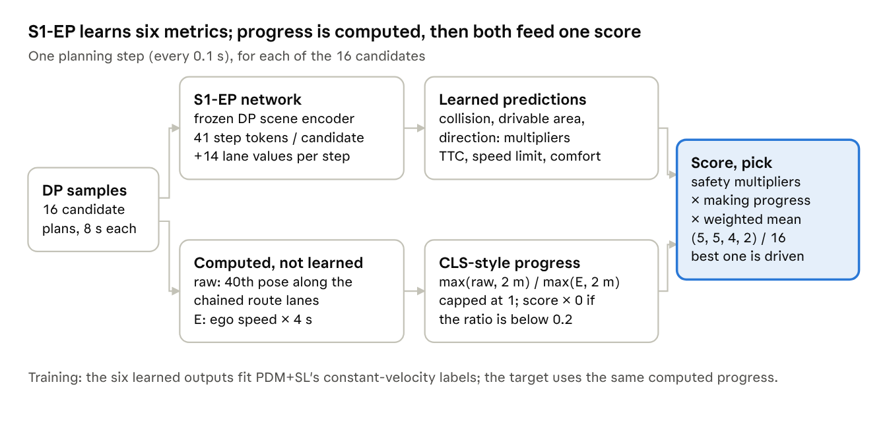

# S1-EP Verifier Architecture

Nov 28, 2026 · @Kaushal · Markdown snapshot of the Claude Doc https://claude.ai/artifact/U25nFyoDXQ2XTB9Kfwwukr

S1-EP is S1 retrained on a CLS-style target: PDM+SL's constant-velocity labels for every metric except progress, which is scored against the ego's own constant-velocity progress (E) using progress computed exactly from the plan, so the model only learns the safety, time-to-collision, speed-limit and comfort predictions.

## Overview

The network predicts only the six metrics PDM+SL labels as safety, TTC, speed limit and comfort; progress and the making-progress gate are computed from the plan and the ego's speed, identically in training and in closed loop.

## Training target

S1-EP is trained to imitate a CLS-style score: PDM+SL's constant-velocity labels for every metric except progress, with progress scored the way CLS scores it, against the ego's constant-velocity progress.

For each candidate k in a sample:

- **Progress** = min(1, max(rawₖ, 2 m) / max(E, 2 m)), and 0 if rawₖ < −2 m. rawₖ is the candidate's computed progress along the route over 4 s; E is the simulated ego's speed × 4 s.
- **Making progress** = 1 if that ratio is at least 0.2, else 0, as a multiplier.
- **Score** = collision × drivable area × driving direction × making progress × (5 · progress + 5 · TTC + 4 · speed limit + 2 · comfort) / 16, with every metric except progress taken from PDM+SL's constant-velocity labels (`metrics_cv`).

|  | S1 (current) | S1-EP |
| --- | --- | --- |
| Progress reference | best of the 16 candidates | E = ego speed × 4 s |
| Progress gated by safety | yes: raw × collision × drivable × direction, then ÷ best | no |
| Raw progress | learned head, trained toward PDM's `progress_cv` | computed from the plan, not learned |
| Making-progress multiplier | no | yes, ratio < 0.2 → 0 |
| Safety and other metrics | PDM+SL's constant-velocity labels | the same |

Going faster than E earns nothing, so the safety multipliers, TTC and comfort decide between candidates that keep up with E. This is the scoring of `oracle_ep` and `pdm_sl_ep` with both of their privileged inputs removed: constant-velocity forecasts instead of logged agent futures, and the ego's own speed instead of the human's logged progress.

## Inputs and computed quantities

Two quantities in the target are computed, not learned, and the same code computes them in training and in closed loop.

| Quantity | How it is computed | Training source | Closed-loop source |
| --- | --- | --- | --- |
| rawₖ: candidate progress over 4 s | chain DP's route-lane inputs into one centerline from the lane under ego, project the current pose and the plan's 40th pose onto it, take the arc-length difference, clip at 0 (`route_progress.py`) | label sample's route lanes and candidates | the planner's model inputs and candidates |
| E: ego's constant-velocity progress | simulated ego's longitudinal speed (clipped at 0) × 4 s | ego speed at that step, read from the label run's simulation logs | the planner input's current ego state |

- rawₖ matches PDM's LQR-tracked raw progress closely: mean error 0.77 m, median 0.31 m, within-scene rank correlation 0.965 (3,000 label samples).
- The label files hold DP's zeroed ego state, and `train-labels-2k-ego` holds the human's logged speed, not the simulated ego's. The ego speed comes from the label-generation run's kept simulation logs instead, through a sidecar (`scripts/make_epcv_sidecar.py`, one file per sample with `ego_speed` and `progress_route`).

What the model still predicts: the six other metrics, from S1's unchanged inputs and architecture. Collision, drivable area and driving direction are multipliers; TTC, speed limit and comfort are weighted terms. Its learned progress head is not used in the score.

## Model and loss

The network is S1 unchanged; only the progress column of its output, the target and the score change.

**Unchanged from S1**

- Diffusion Planner's frozen scene encoder (agents, static objects, 70 lanes, route), cross-attended by the verifier's step tokens.
- One token per scored state: the current state plus the first 40 planned poses (41 per candidate), with pose, velocity, acceleration and speed features and 14 exact lane values per step (`--step-lane scalars`).
- Two decoder layers, 6 heads; per-step heads read by a smooth max for the any-step metrics (collision, drivable area, direction, TTC), the per-step mean for speed limit, attention pooling for comfort.
- Training settings: cv labels, split seed 0 (53,790 train and 5,970 validation samples), 30 epochs, ranking weight 3, ranking temperature 0.02, best epoch by validation regret.

**Changed** (`--progress-mode ep_cv`, `apply_progress_mode` in `train.py`)

- The progress column of the output is overwritten with logit(ratio) from the computed rawₖ and E, in training, validation and closed loop. Its BCE term is then a constant with no gradient, and `--progress-weight 0` turns off the learned raw-progress head's regression loss.
- The per-metric BCE targets for the six other metrics are PDM+SL's constant-velocity labels, as in S1.
- The listwise ranking loss compares the softmax over the 16 candidates of the predicted score with that of the target score, both multiplied by the making-progress gate.
- Validation regret and top-1 are measured against the new target. The logged `pdm` row picks by PDM+SL's own labels with its old progress definition, scored against the new target, as a reference.

**Closed loop**: selector `verifier_ep_cv` with `VERIFIER_RAW=computed` scores each candidate as S1-EP's predicted probabilities × the computed progress ratio × the making-progress gate, and executes the highest; ties go to the lowest index.

## Evidence so far

Rule-based scoring with this target beats PDM+SL in closed loop; S1 with the target applied only at inference does not, though it scores better offline.

**Closed loop** (Test14-hard-100, non-reactive, K = 16, noise 1.5, 3 seeds)

| Selector | CLS (mean ± sd) | Route progress | Comfort | Collision-free |
| --- | --- | --- | --- | --- |
| S1 as is | 75.60 ± 1.43 | 93.1% | 87.7% | 87.0% |
| S1, constant-velocity E at inference only | 75.53 ± 0.79 | 87.5% | 93.7% | 87.5% |
| `pdm_sl` | 78.52 ± 0.51 | 93.3% | 93.3% | 89.5% |
| `pdm_sl_ep_cv`: PDM+SL labels × constant-velocity E | 79.17 ± 0.58 | 92.3% | 93.0% | 90.0% |
| `pdm_sl_ep`: PDM+SL labels × the human's logged progress (ceiling) | 79.83 ± 0.45 | 93.3% | 93.7% | 90.2% |

**Cheap offline check** (5,970 validation samples, no retraining). Target: PDM+SL's constant-velocity labels × CLS-style progress on PDM's raw progress against the simulated ego's speed × 4 s (read from the label run's logs).

| Picks by | Regret (3 seeds) | Top-1 | Pick reaches E | Regret on the 238 samples with mixed collision labels |
| --- | --- | --- | --- | --- |
| PDM+SL's labels, old progress definition | 0.0004 | 0.965 | 0.635 | 0.0012 |
| S1 as is | 0.0313 ± 0.0011 | 0.861 | 0.633 | 0.295 |
| S1, constant-velocity E at inference | **0.0223 ± 0.0006** | 0.829 | 0.569 | **0.172** |

- Offline, scoring S1's progress against E cuts regret by 29% against this target, mostly on samples with mixed collision labels, and most at low speed (below 0.5 m/s: 0.0119 to 0.0018).
- In closed loop the same change gives no gain: comfort rises 6 points, collisions are unchanged and route progress drops 5.6 points. Offline single-step regret has misled twice now, so closed loop decides.
- S1's other predictions were trained with the old progress definition beside them. Retraining on the new target is what S1-EP tests.

## Training and evaluation plan

Queued on aegis on Nov 28, 2026 at 00:41 (`runs/run_s1_ep_cv.sh` in `~/IDL_project/dps-true-e`, tmux session `s1ep`); each step starts only if the one before succeeded.

1. Sidecar for all 59,760 label samples: ego speed from the label run's logs and computed progress for every candidate (about 15 min on CPU).
2. Smoke training: 1 epoch on 5% of the training scenarios.
3. Training, seeds 0 to 2 in sequence (about 2.3 h each, from S1's run times): `python -m diffusion_planner.scorer.train --data ~/nuplan/labels/train-labels-2k --labels cv --split-seed 0 --arch timestep --epochs 30 --step-lane scalars --progress-mode ep_cv --sidecar ~/nuplan/labels/train-labels-2k-epcv --progress-weight 0 --seed <s>`.
4. Closed loop per seed: `SELECTOR=verifier_ep_cv VERIFIER_RAW=computed VERIFIER_TAG=s1ep`, Test14-hard-100, non-reactive, K = 16, noise 1.5, verifier seed = sampling seed.

**Decided by** closed-loop CLS against S1 as is (75.60 ± 1.43), S1 with E at inference (75.53 ± 0.79), `pdm_sl` (78.52 ± 0.51) and `pdm_sl_ep_cv` (79.17 ± 0.58), with route progress, comfort and collision-free rates beside it. Offline, validation regret against the new target (logged every epoch) and collision pair accuracy.

**Risks**

- **Restarting from standstill.** With E = speed × 4 s, a stopped ego has E = 0, so every candidate ties on progress and the target never rewards moving off. S1 with E at inference lost 5.6 points of route progress, possibly partly from this. Fallback: a minimum E when the ego is stopped.
- **Flat collision predictions.** The target removes the speed pull but does not sharpen the collision signal; in the pedestrian scenes S1 rated colliding and collision-free candidates alike. Per-step agent features and a within-scene pairwise collision loss target that.
- **Label-run states.** The labels come from PDM+SL-driven rollouts, so S1-EP learns on states PDM+SL reaches, not the states it reaches itself.

**Where things live**

- Code: branch `true-e-ceiling` (`route_progress.py`, `scripts/make_epcv_sidecar.py`, `--progress-mode ep_cv` in `train.py`, `raw_source` in `VerifierExpertProgressSelector`); not pushed to GitHub.
- Sidecar: `~/nuplan/labels/train-labels-2k-epcv` on aegis.
- Runs: `~/IDL_project/dps-true-e/runs/s1_ep_cv/seed<s>` (checkpoints, `log.jsonl`) and closed-loop runs named `dp_k16_verifier_ep_cv_s1ep_noise1.5[_seed<s>]`.
